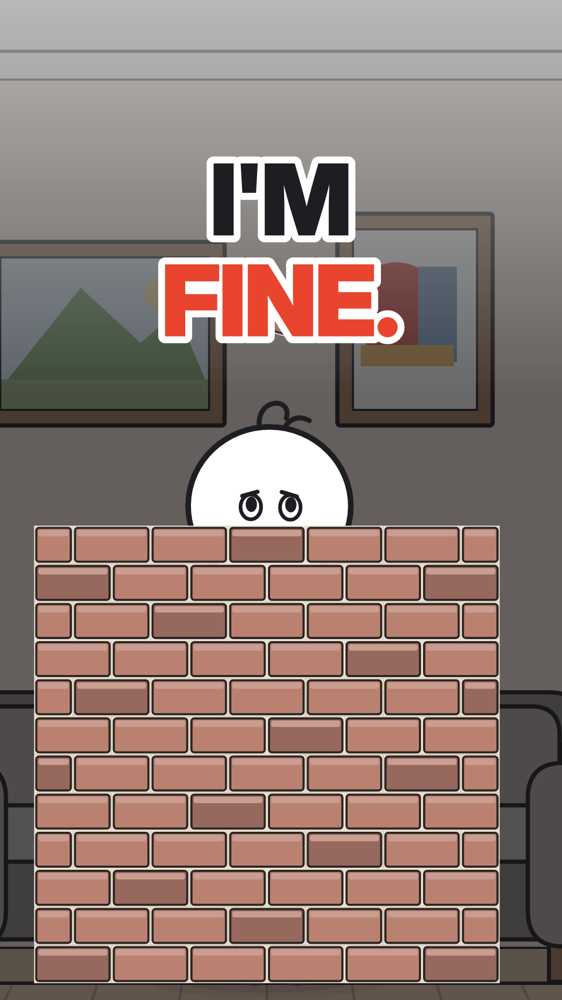
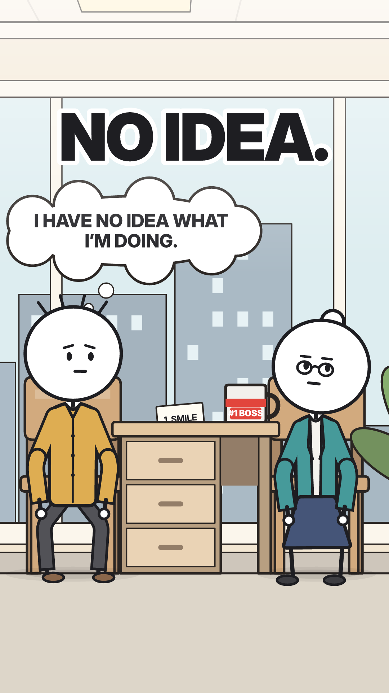
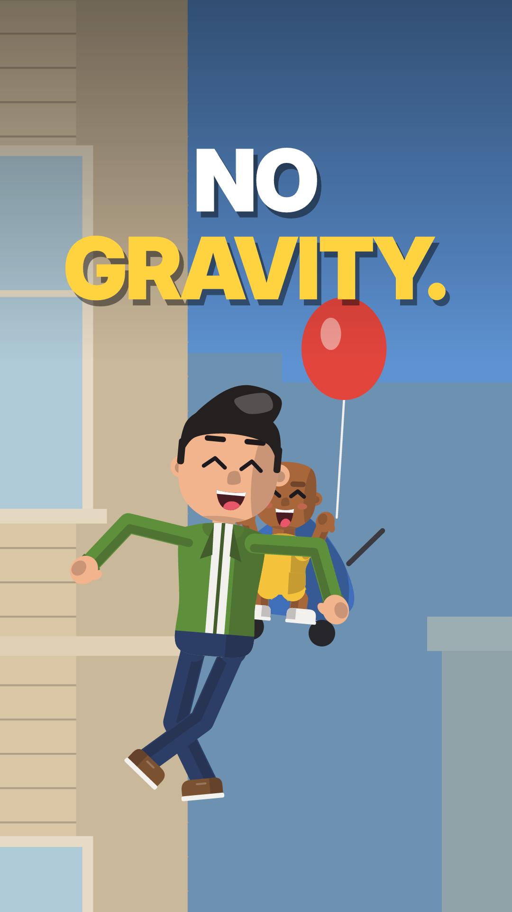
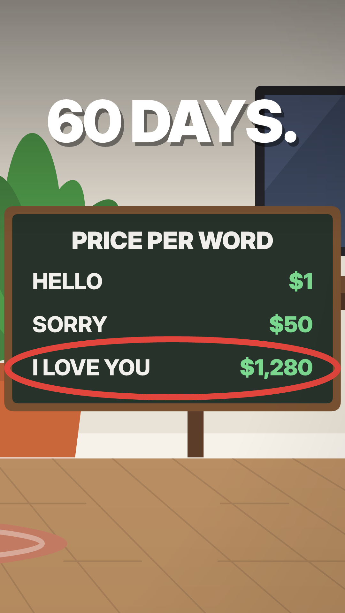

# theunfinishedco

**Silent stickman shorts about strange possibilities, drawn in code.**

theunfinishedco makes 35–45 second vertical videos for YouTube Shorts, Instagram Reels and TikTok. Each one is a
"What if…?" story told with pictures and on-screen text, with no voice-over. Every frame is generated: a story
is one JSON file, and an engine draws it as layered SVG, rasterizes it and encodes the MP4 with designed sound.
The same file renders in two art styles:

| v1 · stick (the channel default) | v2 · flat vector |
|---|---|
| White round heads, ink limbs, softly coloured clothes, a little bow for the women, soft outlined sets | Saturated flat colour, same-hue shading, a free-moving cutout rig, the "YOU VS…" infographic look |
| `--style stick` | `--style flat` |

<p align="center">
  
  
  
  
</p>

<p align="center"></p>

## What's inside

| folder | what it is |
|---|---|
| [`whatif-flat/`](whatif-flat/) | **The engine.** JSON scene → layered SVG frames → resvg → ffmpeg MP4 with sound, in both styles. It includes the character rigs, sets, props, motion system, text and safe-zone system, covers and docs. |
| [`whatif-flat/series2/`](whatif-flat/series2/) | **Series 2**: ten episodes, each one `scene.json` rendered as `NN-slug.mp4` (v2) and `NN-slug-stick.mp4` (v1), with covers. |
| [`whatif-brand/`](whatif-brand/) | **The brand site** (plain HTML/CSS/JS). The v1 and v2 pages run the real engine in the browser: character builder, layers, sets, props, palettes, motion demo, safe-zone viewer, galleries, logo and banner downloads. Light and dark modes. |
| [`whatif-brand/assets/brand/`](whatif-brand/assets/brand/) | **Logo and channel art**: mark, lockups, avatar and the YouTube banner (SVG and PNG), generated by `tools/brand.mjs`. |
| [`skills/`](skills/) | **Claude Code skills** that hold everything learned making this: story and hooks, text and safe zones, motion, production and the channel workflow. See [skills/README.md](skills/README.md). |
| [`profile/voice.md`](profile/voice.md) | The channel profile: voice, rules and platform notes. Every skill reads it first. |
| [`RESEARCH-safe-zones-text.md`](RESEARCH-safe-zones-text.md) | Sourced research on Shorts, Reels and TikTok safe zones, text sizes and reading time. |
| [`music/`](music/) | **Text-to-music**, standalone: generate original music beds locally with [ACE-Step](https://github.com/ace-step/ACE-Step). Nothing else depends on it. See [music/README.md](music/README.md). |
| `whatif-series/`, `whatif-kit/` | **Archive**: Series 1 and the retired canvas kit. The kit's `sfx.py` sound mixer is still used. |
| `whatifman-01/`, `mu-30-days/`, `two-minute-rule/` | Earlier one-off productions from the same pipeline. |

## Quick start

```bash
# requirements: Node ≥ 20, ffmpeg (libx264 + AAC), Python 3 with numpy (for the sound mixer)
cd whatif-flat && npm install                           # installs @resvg/resvg-js 2.7.0-alpha.2

node src/render.mjs examples/park-hello.json --check    # lint: structure, text timing, safe zones
node src/render.mjs examples/park-hello.json --sheet    # contact sheet, one frame per second
node src/render.mjs examples/park-hello.json            # MP4 (v2 flat)
node src/render.mjs examples/park-hello.json --style stick   # MP4 (v1 stick)

cd ../whatif-brand && ./serve.sh                        # brand site → http://localhost:4173
```

**Paths:** a few scripts still use absolute paths from the machine this was made on (`/Users/hussain/dev/...`).
Clone to `~/dev/stickman-videos` or edit them:
- `PY` in `whatif-flat/src/render.mjs` (the Python used for sound)
- the canvas import in `whatif-brand/tools/assets.mjs` and `whatif-kit/kit.mjs`

See [GUIDE.md](GUIDE.md) for the full workflow, from idea to upload.

## How it's made, in one paragraph

A story is written to a fixed shape: a hook image in 0–2.5 s, a plant, the premise at work, a turn at about 55%,
a climax, and a twist that pays off the plant. It's then blocked at real scale: a person is ~1.7 m ≈ 800 px,
and wide shots zoom the camera instead of shrinking the people. Motion is a spline through keyframes with
overlapping action, blended actions and planted feet, and nothing is random per frame. Text stays inside the
Shorts/Reels/TikTok safe area for at least its reading time, with speech bubbles drawn on top of the speaker.
`--check` lints all of that before a frame is rendered.

## Credits

- **Fonts:** Inter and Inter Display (Rasmus Andersson), Instrument Serif (Instrument), JetBrains Mono
  (JetBrains), all SIL OFL 1.1. The licences are in `whatif-flat/fonts/`.
- **YouTube skills** used alongside these (not included here): the `yt-*` skills from
  [Jakeschincariol/youtube-agent-skill](https://github.com/Jakeschincariol/youtube-agent-skill).
- **The first stickman pipeline** started from
  [kaomei/stickman-video-director](https://github.com/kaomei/stickman-video-director).
- Typography follows [hussnakhtr.com](https://hussnakhtr.com).
- Built with Claude Code.
